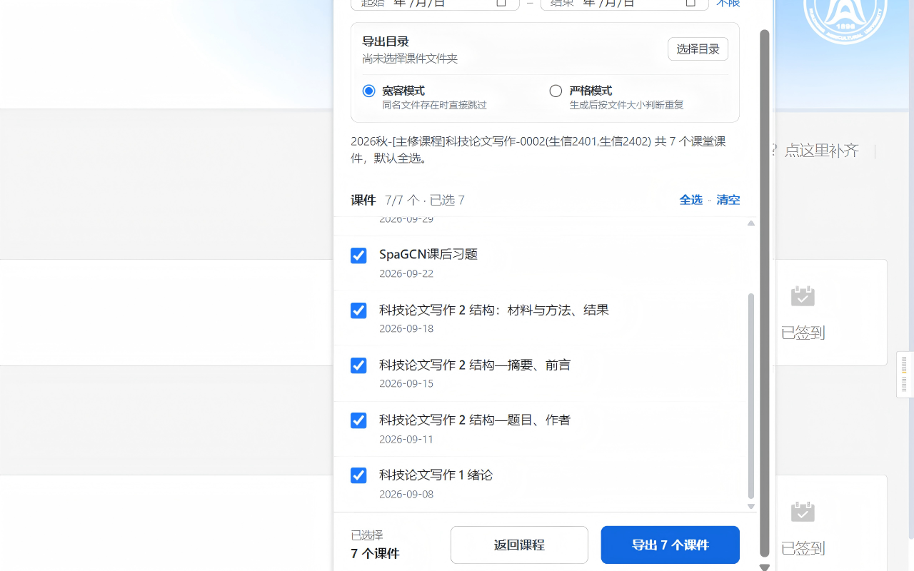

# 雨课堂工具助手 - 批量课件导出 | 课程归档

一个面向雨课堂的 Chromium 浏览器扩展，产品方向为“批量课件导出 | 课程归档”。

> 当前版本支持批量课件导出和课程归档。插件基于长江雨课堂开发，其他雨课堂平台不保证完全兼容。

## 功能概览

- 批量选择课程课件并导出为 PDF。
- 自动识别并跳过重复课件。
- 归档已结束学期的旧课程，保持首页干净。

## 效果预览

### 批量选择课程

### 筛选并导出课件

## 安装

### 方式一：Microsoft Edge 商店安装（推荐）

**该插件已经上架Edge插件商店！**

在 Microsoft Edge 打开扩展商店页面，点击“获取”即可完成安装：

[前往 Microsoft Edge 加载项商店安装](https://microsoftedge.microsoft.com/addons/detail/%E9%9B%A8%E8%AF%BE%E5%A0%82%E5%B7%A5%E5%85%B7%E5%8A%A9%E6%89%8B-%E6%89%B9%E9%87%8F%E8%AF%BE%E4%BB%B6%E5%AF%BC%E5%87%BA-%E8%AF%BE%E7%A8%8B%E5%BD%92%E6%A1%A3/imbcjaljdpbeegmdckaoefkalokkhfij)

### 方式二：Chromium 系浏览器手动安装

适用于 Microsoft Edge、Google Chrome、Chromium 等浏览器：

1. 下载并解压项目文件。
2. 打开浏览器的扩展管理页面（如 Edge 的 `edge://extensions/` 或 Chrome 的 `chrome://extensions/`）。
3. 开启“开发人员模式”或“开发者模式”。
4. 点击“加载解压缩的扩展”或“加载已解压的扩展程序”。
5. 选择包含 `manifest.json` 的仓库目录。

手动安装后，如本地代码发生更新，请在扩展管理页面点击“重新加载”。首次导出时，需要选择并授权现有的“雨课堂课件”目录。

## 文档

详细使用方法、功能逻辑、权限说明、兼容性和开发指南见 [docs/README.md](docs/README.md)。

## 说明

- 扩展不会绕过登录状态、课程权限或网站的内容保护。
- 导出的课件是网站打印流程生成的 PDF，不是原始 PPTX。
- 本项目是非官方工具，与雨课堂及其运营方无隶属或授权关系。
- 请仅归档和导出自己有权访问、保存和使用的内容。
